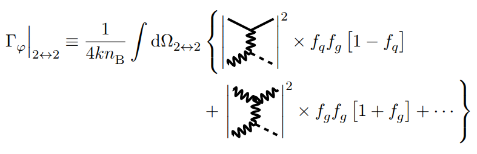
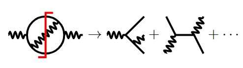

# `minifeyn`





## What

`minifeyn` is a `LaTeX` package for drawing Feynman diagrams in equations.
It's inspired by [feyn](https://www.ctan.org/pkg/feyn) and [TikZ-FeynHand](https://www.ctan.org/pkg/tikz-feynhand).

I used an early version of `minifeyn` in my [PhD thesis](https://github.com/kbtimes3/PhD-thesis/blob/main/manuscript/minifeyn.sty),
but **this** version has been slightly revamped so that it can be used:
- in other contexts,
- by other people (hopefully).

> [!CAUTION]
> For now, there *might* be a bug where two `inlinefeyn` environments (the environement the diagrams should be wrapped in)
> cannot be put on the same line in an equation
> unless one of them is wrapped in a `raisebox` command like *e.g.*
> ```latex
>   \raisebox{0ex}{%
>       \begin{inlinefeyn}
>           \mnftwototwo{mnf-chasca}{mnf-chasca}{mnf-bos}{mnf-chasca}{mnf-chasca}
>       \end{inlinefeyn}
>   }
> ```
> I don't know why it does this, I will try to fix it in the future.

## How

`minifeyn` depends on the following `LaTeX` packages:

- `boolexpr`
- `TikZ`, with the following libraries:
    - `decorations.pathmorphing`
    - `decorations.markings`
    - `arrows.meta`

`minifeyn` is composed of a *single* `.sty` file.
Just put `minifeyn.sty` in the same directory as your document and load it like:

```latex
\usepackage{minifeyn}
```

More instructions can be found in the manual.
Compile it using:

```shell
make docs
```

> [!WARNING]
> The manual uses [minted](https://www.ctan.org/pkg/minted) for syntax highlighting, which requires using the `-shell-escape` option during compilation.
> Some people don't like doing this as it allows for potentially arbitrary commands to be executed.
> If this is your case, your only option is to just read the [manual.tex](./manual.tex) file, I guess.

## Who

Copyright (c) 2026 Killian Bouzoud, MIT license

:hippopotamus:
